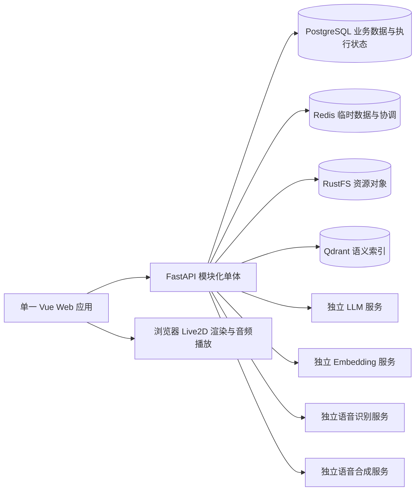

# 项目概览

## 产品定位与工程目标

Yuki 是个人自托管的 Live2D AI 陪伴聊天 Web，主要服务娱乐、角色互动和陪伴体验。项目由个人开发和长期维护，面向真实使用，以正确性、可读性和可维护性作为工程质量要求。

一个部署服务一个使用者，设备间共用该部署的数据与设置。项目只有一个前端，统一提供聊天、角色配置、资源维护和应用设置，没有账号体系。访问该应用即具有其数据与配置操作能力，适用于个人可信访问环境。

产品围绕可配置角色开展文字和语音对话，以 Live2D 展现角色形象，通过长期记忆与背景资料检索支持互动连续性。功能范围见[功能需求](02-feature-requirements.md)。

## 技术选型

| 技术 | 项目职责 | 实践依据与取舍 |
| --- | --- | --- |
| Python 3.12 | 后端运行环境与 AI 生态集成 | 保留已选版本；其处于安全维护阶段，官方计划支持至 2028 年 10 月，初始化时核实所需依赖兼容性；参考 [Python 生命周期](https://devguide.python.org/versions/) |
| FastAPI、Pydantic | HTTP 接入、输入输出模型与校验 | 复用路由、依赖注入和数据校验能力，业务逻辑留在模块服务中；参考 [FastAPI 多文件应用](https://fastapi.tiangolo.com/tutorial/bigger-applications/) |
| SQLAlchemy 2.x、PostgreSQL | 业务数据建模、查询与事务 | 采用现代 ORM 用法，异步操作使用 AsyncSession，避免在异步请求中直接执行阻塞式数据库访问；参考 [SQLAlchemy asyncio](https://docs.sqlalchemy.org/en/20/orm/extensions/asyncio.html) |
| Alembic | 版本化数据库结构变更 | 自动生成的是候选迁移，执行前人工核对；应用启动不自动改业务表；参考 [迁移自动生成说明](https://alembic.sqlalchemy.org/en/latest/autogenerate.html) |
| LangChain、LangGraph | AI 服务集成与对话编排 | 分别复用模型、消息、检索集成和工作流状态能力，不重复建设通用 Agent 框架；参考 [官方职责说明](https://www.langchain.com/oss-overview) |
| Redis | 临时数据、缓存或短期协调 | 每项用途须明确来源、失效与丢失后的影响，不承担唯一业务记录；键名使用项目与业务分段；参考 [Redis 键空间](https://redis.io/docs/latest/develop/using-commands/keyspace/) |
| RustFS、成熟 S3 SDK | Live2D、音频与其他资源对象 | 通过 S3 协议接入，按实际使用 API 检查目标版本兼容范围；参考 [RustFS 兼容矩阵](https://docs.rustfs.com/en/reference/s3-compatibility) |
| Qdrant | 长期记忆和背景资料的语义检索 | PostgreSQL 保存来源与管理信息，Qdrant 保存向量和必要筛选元数据；检索范围由业务约束；参考 [Qdrant 筛选实践](https://qdrant.tech/documentation/search-patterns/vector-search-filtering/) |
| TypeScript、Vue 3、Vite | 单一 Web 应用及其开发构建 | 采用 Vue 生态通行工具链，依赖版本按兼容关系锁定；参考 [Vue 工具链](https://vuejs.org/guide/scaling-up/tooling) |
| Vue Router、Pinia | 页面路由与跨组件、跨页面共享状态 | 局部状态保留在组件或功能内部，按共享需求使用 Pinia；参考 [Vue 状态管理](https://vuejs.org/guide/scaling-up/state-management.html) |
| Naive UI、Tailwind CSS | 通用交互组件与页面布局样式 | Naive UI 提供表单、反馈等组件，Tailwind 负责布局、间距与业务外观；接入时核对全局重置和组件样式；参考 [Naive UI](https://www.naiveui.com/)、[Tailwind Preflight](https://tailwindcss.com/docs/preflight) |
| Axios | 普通 HTTP 请求 | 共享实例集中处理连接配置和公共错误，业务请求按功能组织；流式文字与音频传输按协议选择成熟客户端能力；参考 [Axios 实例](https://axios-http.com/docs/instance) |
| Live2D Cubism Web SDK | 浏览器内角色渲染与表现 | 以官方支持能力和模型兼容性为基准，社区封装库在核实维护情况后选择；参考 [官方 SDK](https://docs.live2d.com/en/cubism-sdk-manual/cubism-sdk-for-web/) |
| uv、pnpm | 后端与前端依赖管理 | 分别维护依赖声明与锁文件，初始化时核实运行时和依赖版本；参考 [uv 项目结构](https://docs.astral.sh/uv/concepts/projects/layout/)、[pnpm 安装](https://pnpm.io/cli/install) |

## 架构与模块边界

后端采用按业务模块组织的单体应用，模块在同一进程内协作，共用由应用组装层管理的基础设施客户端。LLM、Embedding、语音识别和语音合成通过独立服务 API 调用，可以位于本机、局域网或云端；同一个服务可以提供多种能力，不要求分别部署。

| 模块 | 业务职责 | 协作边界 |
| --- | --- | --- |
| 角色 characters | 角色身份、人设及 Live2D、语音、背景资料的关联 | 引用资源、服务配置和资料标识，不直接实现模型推理或资源存储 |
| 会话 conversations | 会话组织、消息记录及用户可见的历史 | 对外提供会话与消息服务，不把 LangGraph 检查点直接作为历史 API |
| 对话 chat | 一次对话的上下文组装、模型调用与结果交付 | 调用其他模块服务，组织 LangGraph 流程，避免其他模块反向依赖聊天编排 |
| 记忆 memory | 跨会话记忆的业务管理与召回范围 | 默认按角色隔离，维护来源关系，借助基础设施进行语义检索 |
| 背景资料 knowledge | 角色背景与世界观资料的管理和检索 | 允许多个角色引用，资料事实与互动产生的记忆分别管理 |
| 资源 assets | Live2D、音频等资源的元数据与对象生命周期 | 统一访问对象存储，角色等模块保存业务关联 |
| 设置 settings | 模型服务、语音服务等应用配置与服务凭据 | 由后端解密后供服务调用使用，不向前端回传密钥明文 |

业务模块通过服务入口协作，保持无循环依赖；数据访问与 ORM 模型由所属模块维护。

模块内部区分 HTTP 接入、业务逻辑与数据访问：接入层完成输入校验和输出转换，业务层执行规则与操作编排，数据访问层维护查询与持久化。按职责和代码体量使用 router、schemas、service、repository、models 等文件或子包。

## 系统拓扑



拓扑表示系统职责与逻辑依赖。模型服务由后端调用，Live2D 渲染和音频播放由浏览器完成，凭据配置见[工程指南](05-engineering-guide.md)。

## 目录组织

后端采用 Python src 布局，前端按应用组装、页面、业务功能与公共能力组织。

```text
backend/
├── pyproject.toml
├── uv.lock
├── migrations/
└── src/yuki/
    ├── main.py
    ├── app/
    ├── modules/
    │   ├── characters/
    │   ├── conversations/
    │   ├── chat/
    │   ├── memory/
    │   ├── knowledge/
    │   ├── assets/
    │   └── settings/
    ├── infrastructure/
    └── shared/

frontend/
└── src/
    ├── app/
    ├── pages/
    ├── features/
    └── shared/

docs/
```

| 位置 | 职责与依赖方向 |
| --- | --- |
| 后端 main.py、app | 应用入口、配置装载、客户端生命周期、依赖组装与路由汇总 |
| 后端 modules | 按业务归属组织模型、接口、规则、数据访问和编排 |
| 后端 infrastructure | 数据库、Redis、S3、向量库与 AI 服务的技术接入，不依赖业务模块 |
| 后端 shared | 被多个模块实际共享的类型与小型公共能力，不容纳无归属的业务逻辑 |
| 后端 migrations | Alembic 环境与迁移版本，供开发者显式执行 |
| 前端 app | 应用初始化、路由、布局、主题和全局提供者 |
| 前端 pages | 页面入口与功能组合，避免在页面内集中实现所有业务 |
| 前端 features | 按角色、聊天、资源、设置等功能组织组件、请求、状态与类型 |
| 前端 shared | 公共 HTTP 能力、通用组件和稳定工具，不反向依赖业务功能 |
| docs | 已确认需求、设计约定与实际接口、数据库契约 |

页面通过功能入口组合业务；需要协调多个功能的逻辑留在页面或应用组装层，避免功能间循环导入。Pinia 按功能归属，组件局部输入与展示状态不默认进入全局状态。

采用 Python src 布局分离导入包与项目根目录，参考 [Python Packaging 指南](https://packaging.python.org/en/latest/discussions/src-layout-vs-flat-layout/)。模块化路由参考 FastAPI 官方能力；具体业务目录和前端组织是结合本项目维护成本作出的约定，不是框架强制标准。

